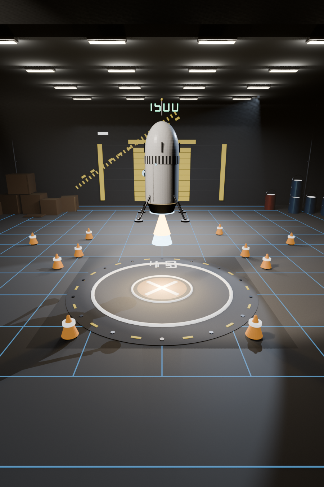
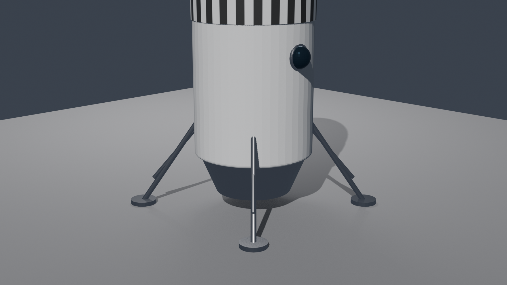
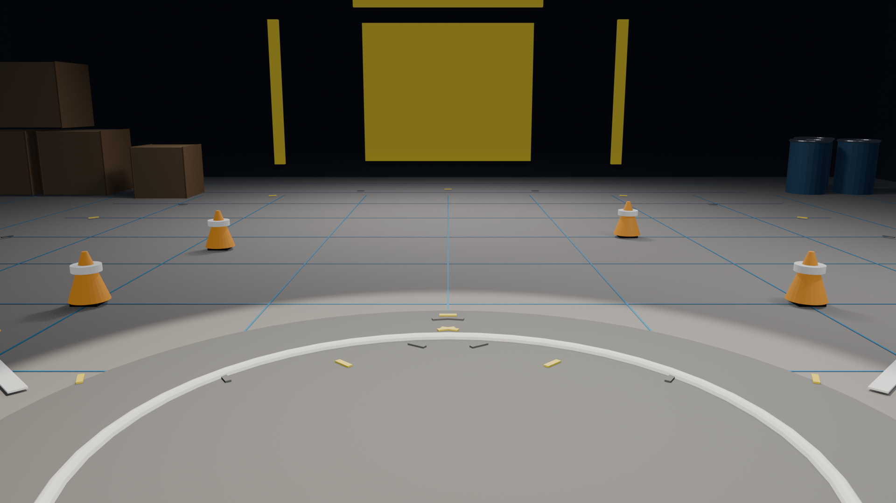

# 🚀 Rocket-Land — Self-Landing Rocket with Deep RL

<p align="center">
  
</p>

<p align="center">
  
  
  
  
  
  
  
</p>

> A reinforcement-learning agent that pilots a lunar lander to a pinpoint landing — then relives each flight live inside a hand-crafted Blender 3D scene.

---

## ✨ What this is

A **Proximal Policy Optimization (PPO)** policy trained on Gymnasium's `LunarLander-v3`, iterated through a 17-stage curriculum with increasingly hostile physics (randomized spawns, gravity, wind, pad position, engine thrust). The final policy is streamed over HTTP into a **real-time Blender viewer** and also baked into an **offline MP4 render**.

| 🎯 Goal | 🧠 Method | 🎨 Showcase |
|---|---|---|
| Precision landing under adversarial physics | Curriculum PPO + custom reward wrappers | Live 3D scene in Blender + rendered episode videos |

---

## 🖼️ Gallery

<table>
  <tr>
    <td align="center"><b>🚀 Rocket</b></td>
    <td align="center"><b>🌑 Landing pad</b></td>
    <td align="center"><b>🎬 Combined scene</b></td>
  </tr>
  <tr>
    <td></td>
    <td></td>
    <td></td>
  </tr>
</table>

📽️ **Watch an agent land:** [`blender/sim_episode.mp4`](blender/sim_episode.mp4)

---

## 🏗️ Architecture

```
            ┌────────────────────────────┐          ┌──────────────────────────────┐
            │   simulator/server.py      │   HTTP   │  blender_viewer.py (Blender) │
  Trained   │   ─ loads PPO .zip         │  :8765   │  ─ modal operator @ 60 Hz    │
  PPO ─────▶│   ─ steps LunarLander-v3   │ ◀───────▶│  ─ polls /state @ 40 Hz      │
  model     │   ─ ThreadingHTTPServer    │   JSON   │  ─ drives RocketRig + flames │
            └────────────────────────────┘          └──────────────────────────────┘
                     │ uses                                   │ renders with
                     ▼                                        ▼
               gymnasium + SB3                     Blender 5.x (Eevee Next)
```

---

## 📁 Repository layout

```
Lunar-Lander-RL/
├── 📂 src/              # all training, evaluation, wrappers, comparison scripts
├── 📂 simulator/        # HTTP backend + Blender live viewer + MP4 recorder
├── 📂 blender/          # .blend scenes, previews, rendered episode videos
├── 📂 models/           # PPO .zip checkpoints — master_best.zip is served live
├── 📂 logs/             # SB3 Monitor CSVs, evaluation summaries, TensorBoard
├── 📂 presentation/     # slide deck + demo clip
├── 🙈 .venv/            # Python virtualenv (gitignored)
├── 📄 .gitignore
└── 📄 README.md
```

---

## 🚀 Quick start

### 1️⃣ Setup

```powershell
python -m venv .venv
.venv\Scripts\activate
pip install gymnasium[box2d] stable-baselines3 tensorboard
```

### 2️⃣ Watch it land (live 3D demo)

```powershell
# Terminal 1 — launch the sim backend
.venv\Scripts\python.exe simulator\server.py
```

Then in **Blender**:
1. Open `blender/combined.blend`
2. Switch to the **Scripting** workspace
3. Open `simulator/blender_viewer.py` → **Run Script**
4. In the viewport: **N-panel → Lunar tab → Play** ▶️

### 3️⃣ Render a video

```powershell
"C:\Program Files\Blender Foundation\Blender 5.2\blender.exe" ^
  -b blender\combined.blend ^
  --python simulator\record_episode.py ^
  -- --frames 450 --out blender\sim_episode.mp4
```

### 4️⃣ Train your own master

```powershell
.venv\Scripts\python.exe src\train_master.py
# or double-click
src\run_train_master.bat
```

### 5️⃣ Evaluate / diagnose

```powershell
.venv\Scripts\python.exe src\evaluate_precision.py
.venv\Scripts\python.exe src\compare_master_candidate.py
.venv\Scripts\python.exe src\diagnose_master.py
```

---

## 🧪 Curriculum ladder

Each stage loads the previous `.zip` as a warm start and bolts on a new challenge wrapper.

| Stage | Model | New challenge | Wrapper |
|---|---|---|---|
| 🥚 baseline | `ppo_lunar_lander_baseline.zip` | vanilla env | — |
| 🪜 v1–v9 | `master_continuous_v{4..9}_candidate.zip` | precision shaping | `TargetLandingWrapper` |
| 🎲 v10–v12 | `master_continuous_v{10..12}_candidate.zip` | random spawns | `RandomStartLunarLander` |
| 🪐 v13 | `master_planet_v13_candidate.zip` | multi-planet gravity | `PlanetLander` |
| 🌍 v14 | `master_v14_gravity_aware.zip` | gravity in observation | `GravityObsLander` |
| 💨 v15 | `master_v15_wind.zip` | lateral wind gusts | `WindyPlanetLander` |
| 🎯 v16 | `master_v16_pad.zip` | moving landing pad | `VariablePadLander` |
| 🔥 v17 | `master_v17_thrust.zip` | randomized engine thrust | `ThrustScaledLunarLander` |
| 🏆 served | **`master_best.zip`** | the deployed champion | — |

---

## 🛠️ Stack

<table>
  <tr>
    <td><b>🧠 RL framework</b></td>
    <td><a href="https://gymnasium.farama.org">Gymnasium</a> · <code>LunarLander-v3</code> · Box2D physics</td>
  </tr>
  <tr>
    <td><b>📈 Policy</b></td>
    <td><a href="https://stable-baselines3.readthedocs.io/">Stable-Baselines3</a> · PPO · PyTorch</td>
  </tr>
  <tr>
    <td><b>🌐 Live backend</b></td>
    <td>Python stdlib <code>http.server.ThreadingHTTPServer</code> (port 8765, JSON)</td>
  </tr>
  <tr>
    <td><b>🎨 Frontend</b></td>
    <td>Blender 5.x <code>bpy</code> — modal operator + N-panel</td>
  </tr>
  <tr>
    <td><b>🎬 Offline render</b></td>
    <td>Blender headless → PNG sequence → OpenCV MP4 stitch</td>
  </tr>
  <tr>
    <td><b>📊 Metrics</b></td>
    <td>SB3 <code>Monitor</code> CSVs + TensorBoard</td>
  </tr>
</table>

---

## 📡 HTTP API (`simulator/server.py`)

| Method | Path | Returns |
|---|---|---|
| `GET` | `/state` | current observation, action, episode, reward, totals |
| `POST` | `/reset` | start a new episode |
| `POST` | `/pause` | pause stepping |
| `POST` | `/resume` | resume stepping |
| `GET` | `/health` | `{ok, model_path}` |

Observation (8 floats): `[x, y, vx, vy, angle, angular_velocity, leg1_contact, leg2_contact]`
Action (discrete 4): `0=noop · 1=left · 2=main · 3=right`

---

## 📚 Further reading

- [`simulator/README.md`](simulator/README.md) — live-demo architecture & troubleshooting
- Gymnasium docs — https://gymnasium.farama.org
- SB3 PPO — https://stable-baselines3.readthedocs.io/en/master/modules/ppo.html

---

<p align="center">
  <sub>Built with 🤍 and a lot of crashed landers.</sub>
</p>
